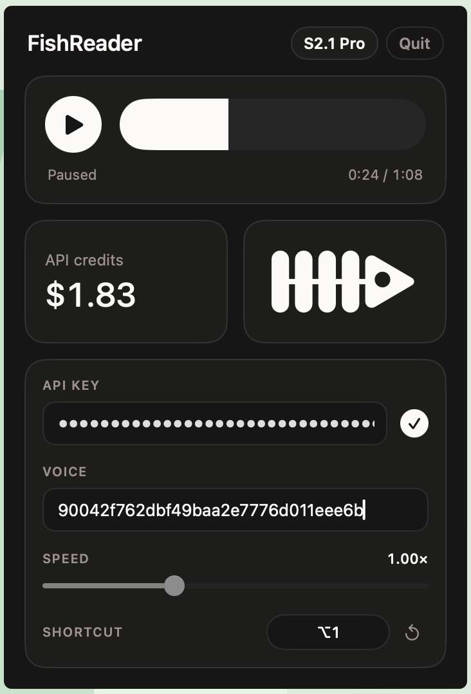

# FishReader

Select text anywhere on your Mac, press a shortcut (default ⌃⌥S) and hear it read aloud with Fish Audio's S2.1 Pro voice.

## Install

1. Download `FishReader.dmg` from [Releases](../../releases) and drag the app to Applications.
2. First launch: System Settings → Privacy & Security → **Open Anyway**.
3. Allow Accessibility access and add your [Fish Audio](https://fish.audio) API key.

Requires macOS 14 or later.

## Build

`./build.sh` builds the app, `./make_dmg.sh` builds the DMG (only needs the Xcode Command Line Tools).

*Not affiliated with Fish Audio.*
